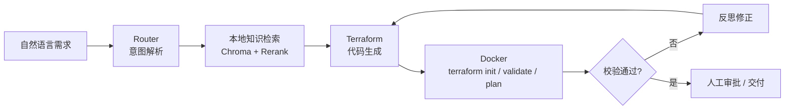

# Huawei Cloud Terraform AI Agent

<p align="center">
  
  
  
  
</p>

一个基于 LangGraph 的华为云 Terraform AI 智能体：把自然语言需求转成 Terraform 工程，并在 Docker 沙箱中完成校验与自愈修正。

## 项目概览



### 亮点

- 自然语言转 Terraform 工程
- 本地知识库增强生成质量
- 独立任务工作区隔离
- 自动修正 + 人工复核
- 适合 IaC 智能体原型与学习场景

## 快速开始

### 1. 安装依赖

```bash
python -m venv .venv

# Linux / macOS
source .venv/bin/activate

# Windows PowerShell
.\.venv\Scripts\Activate.ps1

pip install -r requirements.txt
```

### 2. 配置环境变量

```bash
copy .env.example .env
```

示例配置：

```env
DASHSCOPE_BASE_URL=https://your-dashscope-base-url
DASHSCOPE_API_KEY=your-dashscope-api-key

OPENAI_BASE_URL=https://your-openai-compatible-base-url
OPENAI_API_KEY=your-openai-compatible-key

HW_ACCESS_KEY=your-huawei-access-key
HW_SECRET_KEY=your-huawei-secret-key
HW_REGION_NAME=cn-north-4
```

### 3. 准备知识库

```bash
python rag_embedding/embedding.py
```

### 4. 启动程序

```bash
python main.py
```

## 项目结构

```text
.
├── agent_core/
│   ├── cli.py                 # 交互式 CLI 入口与任务执行
│   ├── config.py              # 环境变量安全读取与校验
│   ├── graph.py               # LangGraph 编排与条件分支
│   ├── model_adapter.py       # 模型封装层：embedding / rerank / API 适配
│   ├── nodes.py               # 路由、检索、生成、验证、反思等节点
│   ├── node_utils.py          # 代码落盘、差异提取与辅助函数
│   ├── rag_retriever.py       # 懒加载 Chroma 检索主逻辑
│   ├── services/
│   │   ├── llm_service.py     # LLM 服务封装
│   │   ├── retrieval_service.py
│   │   ├── workspace_service.py
│   │   └── __init__.py
│   └── state.py               # LangGraph state 定义
├── rag_embedding/
│   ├── create_chunk.py        # 生成知识块
│   └── embedding.py           # 生成 / 更新向量库
├── chroma_db_storage/         # 本地 Chroma DB 数据目录
├── main.py                    # 运行入口
├── requirements.txt           # Python 依赖
├── README.md                  # 中文说明
├── README_EN.md               # 英文说明
├── .env.example               # 环境变量模板
├── LICENSE                    # MIT 开源协议
```

> 说明：`workspaces/`、`chroma_db_storage/`、`chunks_cache/` 等目录通常会保留为本地运行产物，不建议全量提交到 Git。

## 注意事项

- 首次运行前需要准备知识库，尤其是本地 Chroma 数据。
- Docker 容器校验依赖镜像 `tf-sandbox:huawei`。
- API Key 和云账号敏感信息必须通过环境变量注入，避免硬编码。
- 任务输出写入 `workspaces/`，适合本地调试与交付审阅。

## 许可证

本项目采用 MIT License。详情见 [LICENSE](LICENSE)。

## 参考资料

- LangGraph: https://github.com/langchain-ai/langgraph
- LangChain: https://github.com/langchain-ai/langchain
- ChromaDB: https://github.com/chroma-core/chroma
- Terraform: https://www.terraform.io/
- Huawei Cloud: https://www.huaweicloud.com/
