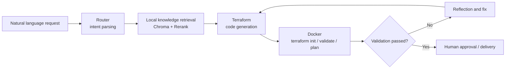

# Huawei Cloud Terraform AI Agent

<p align="center">
  
  
  
  
</p>

A LangGraph-based Huawei Cloud Terraform AI agent that turns natural-language requirements into executable Terraform code and validates it in a Docker sandbox.

## Overview



### Highlights

- Natural-language to Terraform workflow
- Retrieval-augmented code generation
- Output stored in isolated task workspaces
- Automated validation and repair loop
- Human review before delivery

## Quick Start

### 1. Install dependencies

```bash
python -m venv .venv

# Linux / macOS
source .venv/bin/activate

# Windows PowerShell
.\.venv\Scripts\Activate.ps1

pip install -r requirements.txt
```

### 2. Configure environment variables

```bash
copy .env.example .env
```

Example configuration:

```env
DASHSCOPE_BASE_URL=https://your-dashscope-base-url
DASHSCOPE_API_KEY=your-dashscope-api-key

OPENAI_BASE_URL=https://your-openai-compatible-base-url
OPENAI_API_KEY=your-openai-compatible-key

HW_ACCESS_KEY=your-huawei-access-key
HW_SECRET_KEY=your-huawei-secret-key
HW_REGION_NAME=cn-north-4
```

### 3. Prepare the knowledge base

```bash
python rag_embedding/embedding.py
```

### 4. Run the project

```bash
python main.py
```

## Project Structure

```text
.
├── agent_core/
│   ├── cli.py                 # Interactive CLI and task orchestration
│   ├── config.py              # Environment variable validation
│   ├── graph.py               # LangGraph orchestration and routing
│   ├── model_adapter.py       # Embedding/rerank/model API adapter
│   ├── nodes.py               # Router, retrieval, generation, validation, and reflection nodes
│   ├── node_utils.py          # File writing and helper utilities
│   ├── rag_retriever.py       # Lazy Chroma retrieval implementation
│   ├── services/
│   │   ├── llm_service.py     # LLM service wrapper
│   │   ├── retrieval_service.py
│   │   ├── workspace_service.py
│   │   └── __init__.py
│   └── state.py               # Shared state schema
├── rag_embedding/
│   ├── create_chunk.py        # Chunk generation
│   └── embedding.py           # Vector store generation and sync
├── chroma_db_storage/         # Local Chroma DB storage directory
├── main.py                    # Entry point
├── requirements.txt           # Python dependencies
├── README.md                  # Chinese documentation
├── README_EN.md               # English documentation
├── .env.example               # Environment variable template
├── .gitignore                 # Git ignore rules
├── LICENSE                    # MIT license
└── .venv/                     # Local Python environment
```


## Notes

- The first run usually requires local Chroma data preparation.
- Docker validation depends on the `tf-sandbox:huawei` image.
- Sensitive credentials should be provided through environment variables only.
- Generated Terraform files are stored in `workspaces/` for local review and delivery.

## License

This project is licensed under the MIT License. See [LICENSE](LICENSE).

## Reference Links

- LangGraph: https://github.com/langchain-ai/langgraph
- LangChain: https://github.com/langchain-ai/langchain
- ChromaDB: https://github.com/chroma-core/chroma
- Terraform: https://www.terraform.io/
- Huawei Cloud: https://www.huaweicloud.com/
